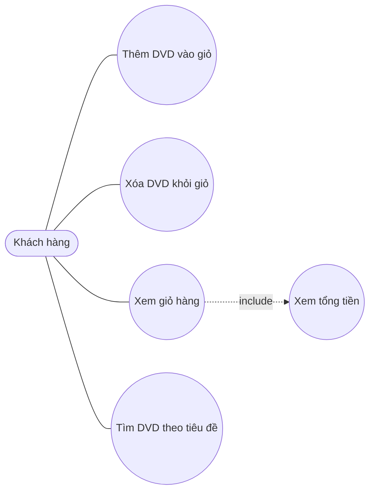

# AIMS-mini – Use case

## Tác nhân

- **Khách hàng**: người mua đĩa DVD qua chương trình dòng lệnh.

## Sơ đồ use case

## Mô tả ngắn

| Use case | Mô tả | Hiện thực |
|---|---|---|
| Thêm DVD vào giỏ | Thêm một đĩa, tối đa `MAX_NUMBERS_ORDERED` đĩa | `Cart.add_dvd()` |
| Xóa DVD khỏi giỏ | Xóa một đĩa đang có trong giỏ | `Cart.remove_dvd()` |
| Xem giỏ hàng | In danh sách đĩa và tổng tiền; giỏ trống thì báo "The cart is empty" | `Cart.print_cart()` |
| Tìm DVD theo tiêu đề | Trả về các đĩa có tiêu đề chứa từ khóa | `search_by_title()` |
| Xem tổng tiền | Tính tổng giá các đĩa trong giỏ | `Cart.total_cost()` |
